# Casos de Uso y Plan de Pruebas

Sistema de Facturación Básico (Flask + AdminLTE). El documento completo, con las capturas, está en [`Plan_de_Pruebas_Facturacion.docx`](Plan_de_Pruebas_Facturacion.docx); las imágenes están en [`capturas/`](capturas/).

## Casos de uso

### CU-01 · Iniciar y cerrar sesión

**Actor:** Administrador / Vendedor  
**Precondición:** El usuario está registrado en la tabla usuarios (los usuarios de prueba se crean con seed.py).

**Flujo principal:**

1. El usuario abre /login.
2. Ingresa email y contraseña y presiona Ingresar.
3. El sistema busca el usuario por email (Usuario.query.filter_by) y compara la contraseña contra el hash guardado.
4. El sistema guarda el id del usuario en la sesión y muestra el Dashboard con el mensaje de bienvenida.
5. Para salir, el usuario presiona Salir y el sistema borra la sesión.

**Flujos alternativos:**

- 2a. Algún campo vacío: «Completá email y contraseña.»
- 3a. Email o contraseña incorrectos: «Usuario o contraseña incorrectos.» (el mismo mensaje en los dos casos, para no revelar cuál falló).
- Un Vendedor intenta entrar a un ABM: «Solo el Administrador puede acceder a esa sección.»
- Alguien sin sesión entra a cualquier pantalla: se lo envía al login con «Iniciá sesión para continuar.»

**Postcondición:** Sesión iniciada (o cerrada).  
**Ruta:** `/login, /logout` · **Pruebas:** CP-01, CP-02, CP-03, CP-04, CP-30

### CU-02 · ABM Cliente

**Actor:** Administrador  
**Precondición:** Sesión iniciada con rol Administrador.

**Flujo principal:**

1. El Administrador entra a Clientes y ve el listado.
2. Alta: presiona «Nuevo cliente», carga los datos y presiona Guardar.
3. El sistema valida cada campo con las reglas de entidades.py.
4. El sistema guarda el cliente y muestra la confirmación «Cliente #N creado correctamente.»
5. Modificación: presiona «Modificar» en una fila, cambia datos y presiona Guardar.
6. Baja: presiona «Eliminar» en una fila, el sistema pide confirmación y el Administrador elige «Sí, eliminar».

**Flujos alternativos:**

- 3a. Datos inválidos: se muestra un mensaje por cada campo con error, el formulario conserva lo escrito y no se guarda nada.
- 3b. Email ya usado por otro cliente: «Email: ya existe otro cliente con ese valor.»
- 5a. El cliente no existe (por ejemplo, /clientes/99/editar): «No existe el cliente #99.»
- 6a. El Administrador elige «No, volver»: «Eliminación cancelada. No se borró nada.»
- 6b. El cliente tiene facturas: «No se puede eliminar: el cliente tiene facturas emitidas.»

**Postcondición:** El cliente queda guardado, modificado o eliminado en la tabla clientes.  
**Ruta:** `/clientes/` · **Pruebas:** CP-05 a CP-14

### CU-03 · ABM Producto

**Actor:** Administrador  
**Precondición:** Sesión iniciada con rol Administrador.

**Flujo principal:**

1. El Administrador entra a Productos y ve el listado.
2. Alta: presiona «Nuevo producto», carga descripción, precio y stock y presiona Guardar.
3. El sistema valida los datos con las reglas de entidades.py.
4. El sistema guarda el producto y muestra la confirmación.
5. Modificación y baja: igual que en CU-02.

**Flujos alternativos:**

- 3a. Precio o stock no numéricos, negativos o fuera de rango: un mensaje por campo.
- 3b. Descripción repetida: «Descripción: ya existe otro producto con ese valor.»
- 5a. El producto figura en alguna factura: «No se puede eliminar: el producto figura en facturas emitidas.»

**Postcondición:** El producto queda guardado, modificado o eliminado en la tabla productos.  
**Ruta:** `/productos/` · **Pruebas:** CP-15 a CP-21

### CU-04 · Emitir factura

**Actor:** Usuario autorizado (Administrador o Vendedor)  
**Precondición:** Sesión iniciada. Hay al menos un cliente y un producto con stock.

**Flujo principal:**

1. El usuario entra a «Emitir factura».
2. Selecciona el cliente.
3. Agrega renglones (producto + cantidad). La pantalla calcula subtotales y total a medida que se carga.
4. Presiona «Confirmar factura».
5. El sistema controla los datos y el stock, toma los precios de la base de datos y guarda en una sola transacción la factura, su detalle y el descuento de stock.
6. El sistema muestra el detalle de la factura emitida.

**Flujos alternativos:**

- 4a. Sin cliente o con renglones incompletos: un mensaje por problema (por ejemplo «Renglón 1: falta elegir el producto.»).
- 5a. Cantidad mayor al stock: «Stock insuficiente para «Producto»: pediste X y hay Y.» No se guarda nada y la pantalla conserva lo cargado.
- 5b. El mismo producto en dos renglones: el sistema suma las cantidades antes de controlar el stock.

**Postcondición:** Se crean los registros en facturas y detalle_factura, y se descuenta el stock de cada producto.  
**Ruta:** `/facturas/nueva` · **Pruebas:** CP-22, CP-23, CP-24

### CU-05 · Consultar factura

**Actor:** Usuario autorizado  
**Precondición:** Sesión iniciada.

**Flujo principal:**

1. El usuario entra a «Consultar facturas».
2. Elige un cliente y/o las fechas Desde y Hasta y presiona Buscar.
3. El sistema lista las facturas que cumplen los filtros.
4. El usuario presiona «Ver detalle» y el sistema muestra la factura con sus renglones (con opción de imprimir).

**Flujos alternativos:**

- 2a. «Desde» posterior a «Hasta»: «La fecha 'Desde' no puede ser posterior a 'Hasta'.» y se listan todas.
- 3a. Sin resultados: «No se encontraron facturas con esos filtros.»
- 4a. Factura inexistente: «No existe la factura #N.»

**Postcondición:** Ninguna (solo consulta).  
**Ruta:** `/facturas/, /facturas/<id>` · **Pruebas:** CP-25, CP-26, CP-27

### CU-06 · Reporte de facturas por cliente

**Actor:** Usuario autorizado  
**Precondición:** Sesión iniciada.

**Flujo principal:**

1. El usuario entra a «Facturas por cliente».
2. El sistema agrupa las facturas por cliente (GROUP BY con el ORM) y muestra cantidad, total y total general.
3. Con «Ver facturas» se pasa al listado de CU-05 filtrado por ese cliente.

**Flujos alternativos:**

- Los clientes sin facturas aparecen con 0 (se usa un outer join).

**Postcondición:** Ninguna (solo consulta).  
**Ruta:** `/reportes/por-cliente` · **Pruebas:** CP-28

### CU-07 · Reporte de ventas por período

**Actor:** Usuario autorizado  
**Precondición:** Sesión iniciada.

**Flujo principal:**

1. El usuario entra a «Ventas por período» (por defecto se muestra el mes actual).
2. Elige Desde y Hasta y presiona Consultar.
3. El sistema muestra el total vendido, la cantidad de facturas y el detalle por día.

**Flujos alternativos:**

- 2a. «Desde» posterior a «Hasta»: aviso y se muestra el mes actual.
- 3a. Sin ventas: «No hubo ventas en el período.»

**Postcondición:** Ninguna (solo consulta).  
**Ruta:** `/reportes/por-periodo` · **Pruebas:** CP-29

## Plan de pruebas

### CP-01 · Login con campos vacíos (CU-01)

Precondición: Pantalla de login abierta.  
Pasos: Presionar Ingresar sin completar nada.  
Esperado: Mensaje «Completá email y contraseña.» y no se inicia sesión.  
Resultado: OK.

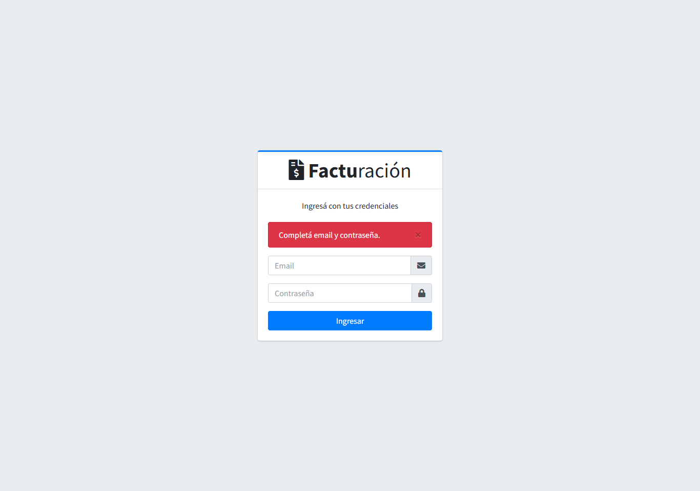

### CP-02 · Login con contraseña incorrecta (CU-01)

Precondición: Pantalla de login abierta.  
Pasos: Ingresar admin@facturacion.com con la contraseña «otra_clave».  
Esperado: Mensaje «Usuario o contraseña incorrectos.»; el email queda escrito para no tener que repetirlo.  
Resultado: OK.

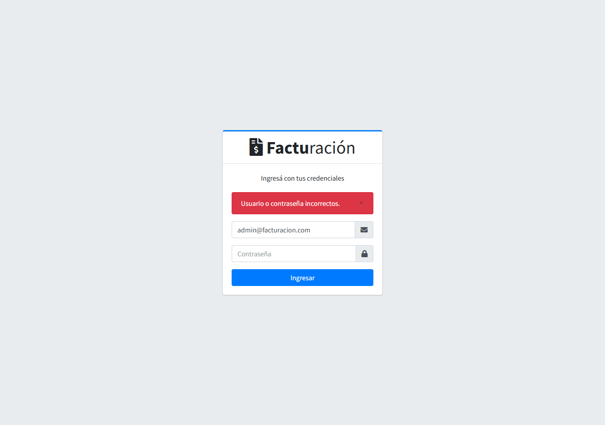

### CP-03 · Login correcto (CU-01)

Precondición: Pantalla de login abierta.  
Pasos: Ingresar admin@facturacion.com / admin123.  
Esperado: Se abre el Dashboard con «¡Bienvenido/a, Administrador!», los indicadores y las últimas facturas.  
Resultado: OK.

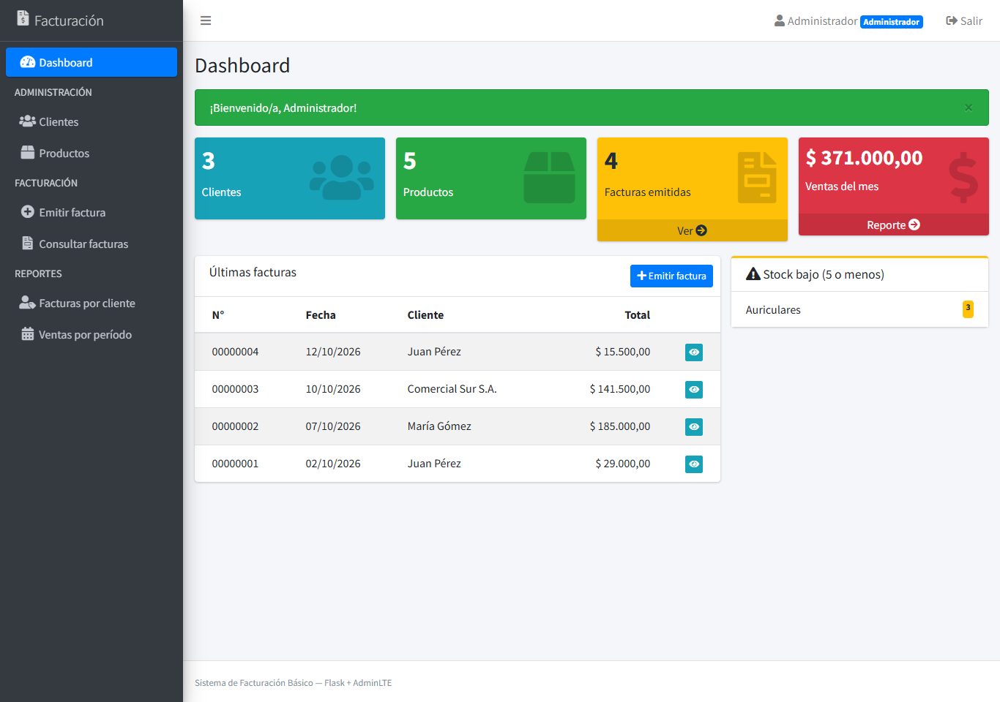

### CP-04 · Vendedor intenta entrar al ABM (CU-01)

Precondición: Sesión iniciada como vendedor@facturacion.com.  
Pasos: Escribir en la barra de direcciones /clientes/.  
Esperado: Vuelve al Dashboard con «Solo el Administrador puede acceder a esa sección.» El menú del Vendedor no muestra Clientes ni Productos.  
Resultado: OK. El control está en el servidor (decorador solo_admin), no solo en el menú.

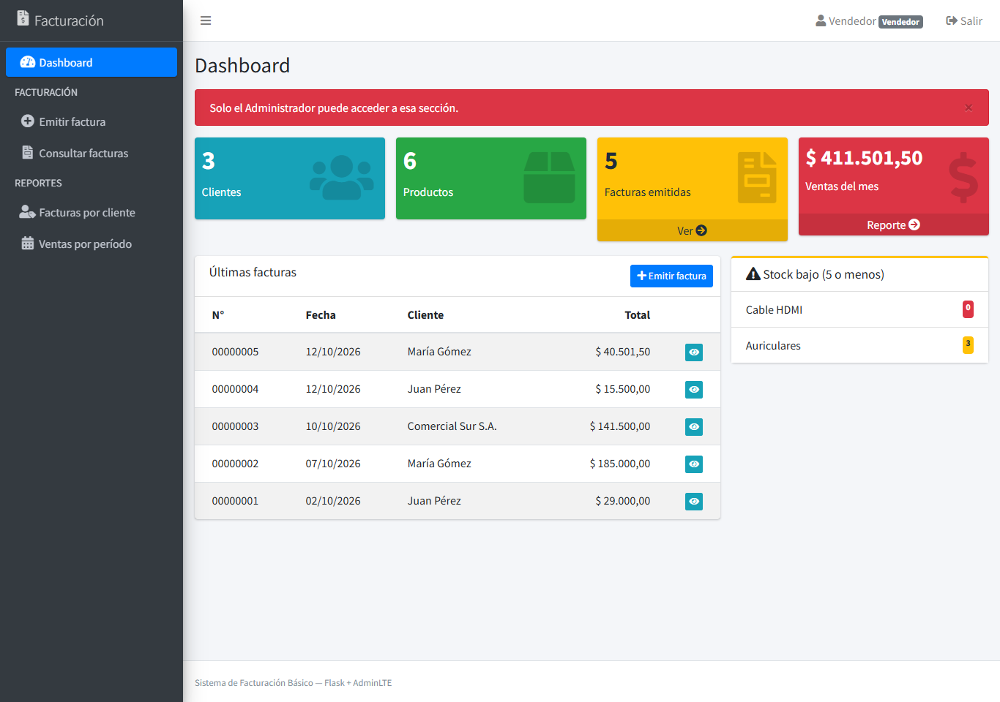

### CP-05 · Listado de clientes (CU-02)

Precondición: Sesión de Administrador.  
Pasos: Entrar a Clientes.  
Esperado: Tabla con los clientes cargados, botones Modificar / Eliminar y el total de registros.  
Resultado: OK.

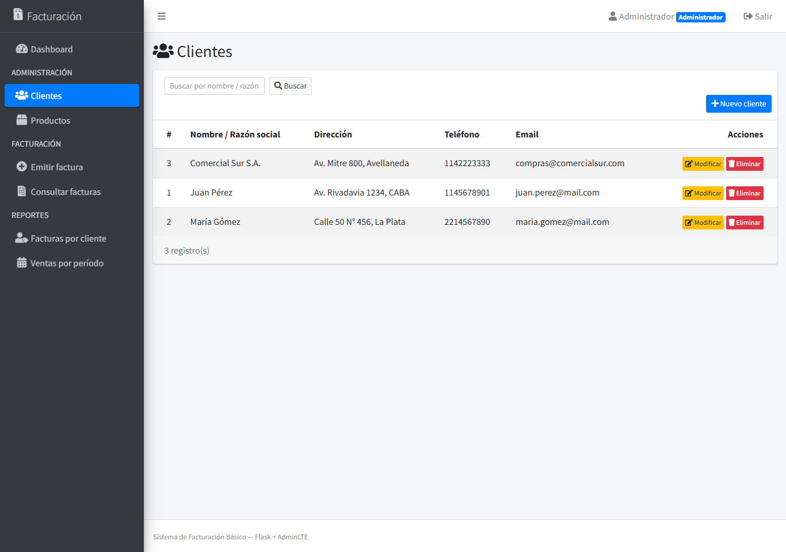

### CP-06 · Búsqueda de clientes (CU-02)

Precondición: Listado de clientes abierto.  
Pasos: Escribir «gómez» en el buscador y presionar Buscar.  
Esperado: Solo aparece «María Gómez» (la búsqueda no distingue mayúsculas).  
Resultado: OK. «1 registro(s)».

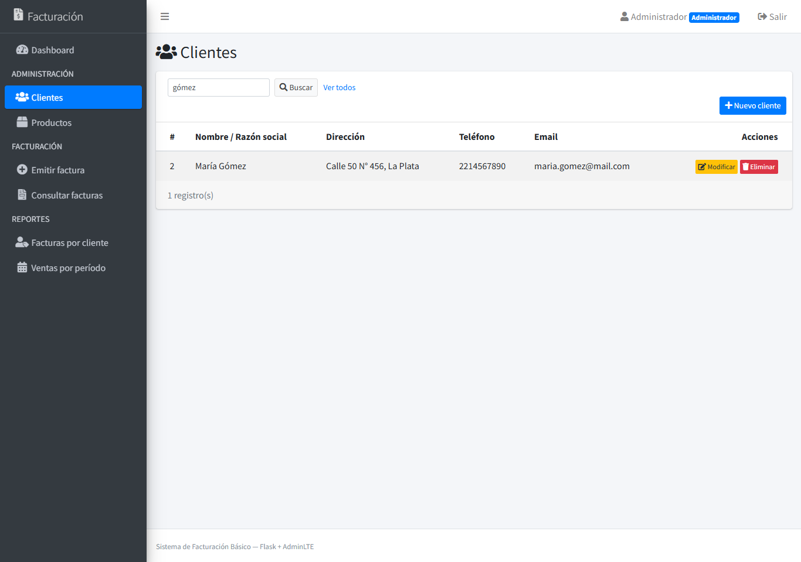

### CP-07 · Alta de cliente con campos vacíos: un mensaje por campo (CU-02)

Precondición: Formulario «Nuevo cliente» vacío.  
Pasos: Presionar Guardar sin escribir nada.  
Esperado: Un mensaje por cada campo obligatorio (Nombre, Teléfono y Email); Dirección no se marca porque es opcional. No se crea ningún registro.  
Resultado: OK. Los campos con error quedan en rojo con su mensaje debajo.

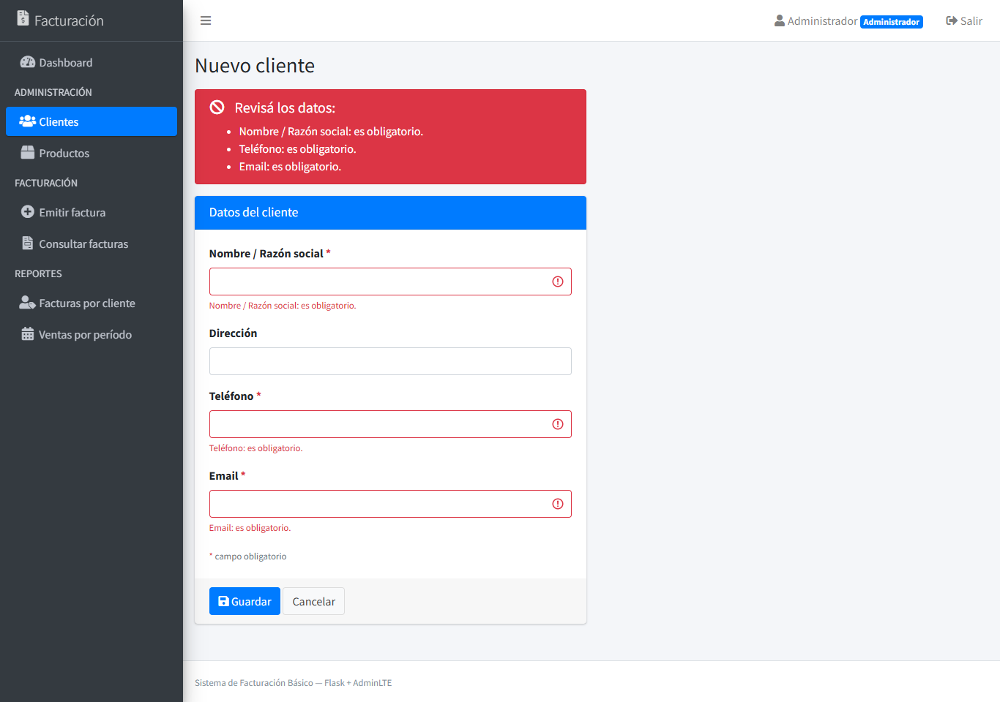

### CP-08 · Alta de cliente con datos inválidos (CU-02)

Precondición: Formulario «Nuevo cliente».  
Pasos: Cargar Nombre «Ana2», Teléfono «341-555-1234» y Email «ana.mail.com»; presionar Guardar.  
Esperado: Tres mensajes juntos: nombre con números, teléfono con guiones (mensaje propio de la regla) y email sin @.  
Resultado: OK. El formulario conserva lo escrito para corregirlo.

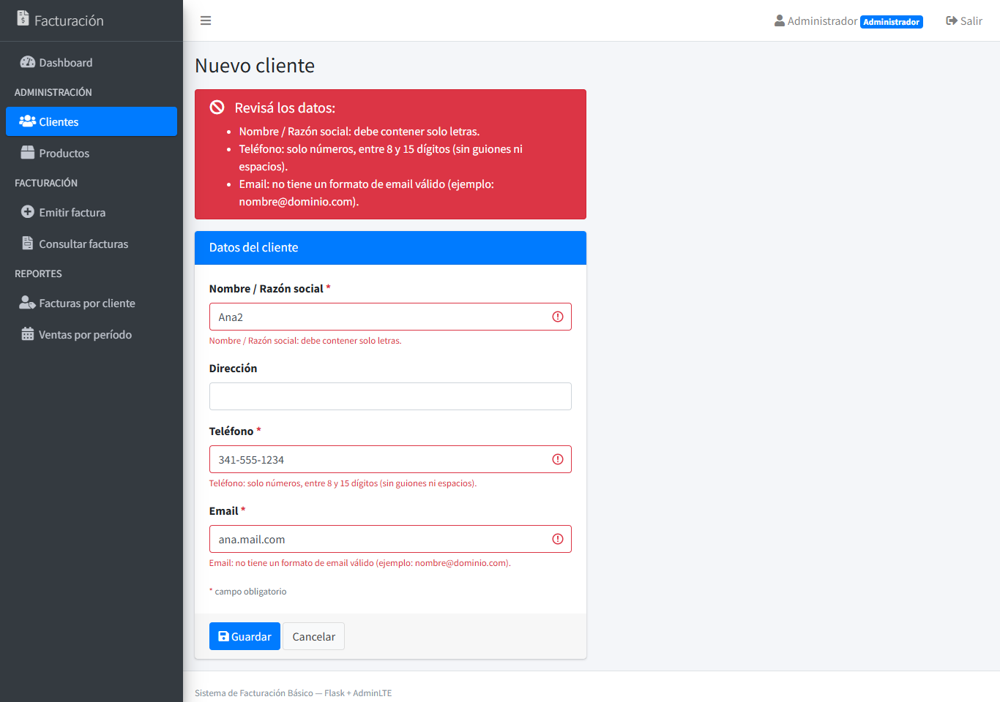

### CP-09 · Email de cliente repetido (CU-02)

Precondición: Existe el cliente juan.perez@mail.com.  
Pasos: Dar de alta «Pedro Ruiz» con el email juan.perez@mail.com.  
Esperado: «Email: ya existe otro cliente con ese valor.» y no se guarda.  
Resultado: OK (regla «unico»).

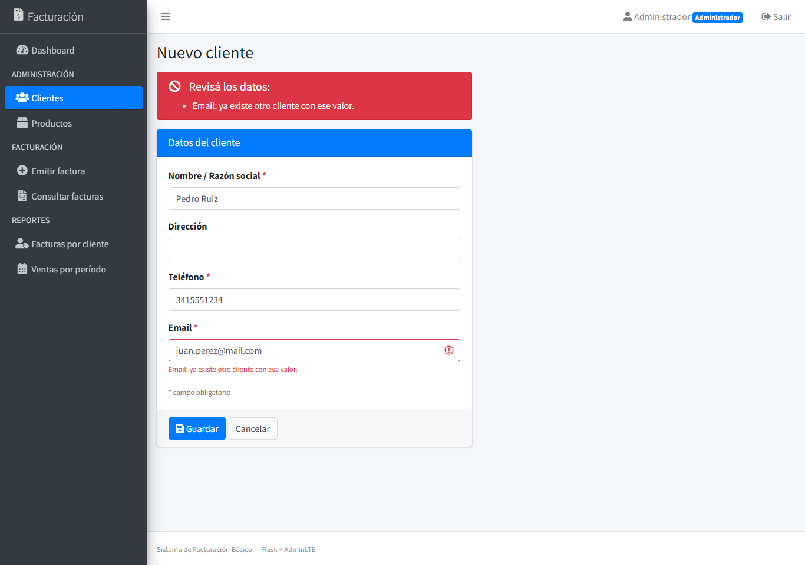

### CP-10 · Alta válida de cliente (CU-02)

Precondición: Formulario «Nuevo cliente».  
Pasos: Cargar Ana Gómez / Bv. Oroño 1500, Rosario / 3415559876 / ana.gomez@mail.com; presionar Guardar.  
Esperado: Vuelve al listado con «Cliente #4 creado correctamente.» y la fila nueva.  
Resultado: OK.

### CP-11 · Modificación de cliente (CU-02)

Precondición: Existe el cliente #4.  
Pasos: Presionar Modificar en Ana Gómez (el formulario se abre con sus datos), cambiar el teléfono a 3416001122 y Guardar.  
Esperado: «Cliente #4 modificado correctamente.» y el teléfono actualizado en la tabla.  
Resultado: OK.

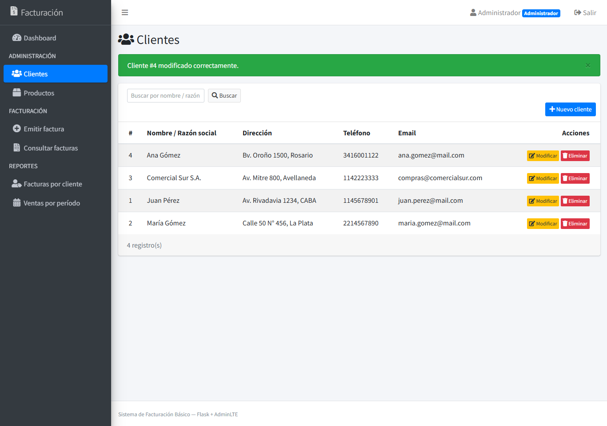

### CP-12 · Modificar un cliente que no existe (CU-02)

Precondición: No existe el cliente #99.  
Pasos: Escribir en la barra de direcciones /clientes/99/editar.  
Esperado: No se rompe: vuelve al listado con «No existe el cliente #99.»  
Resultado: OK. Equivale al caso «Actualizar sin seleccionar» del TP anterior.

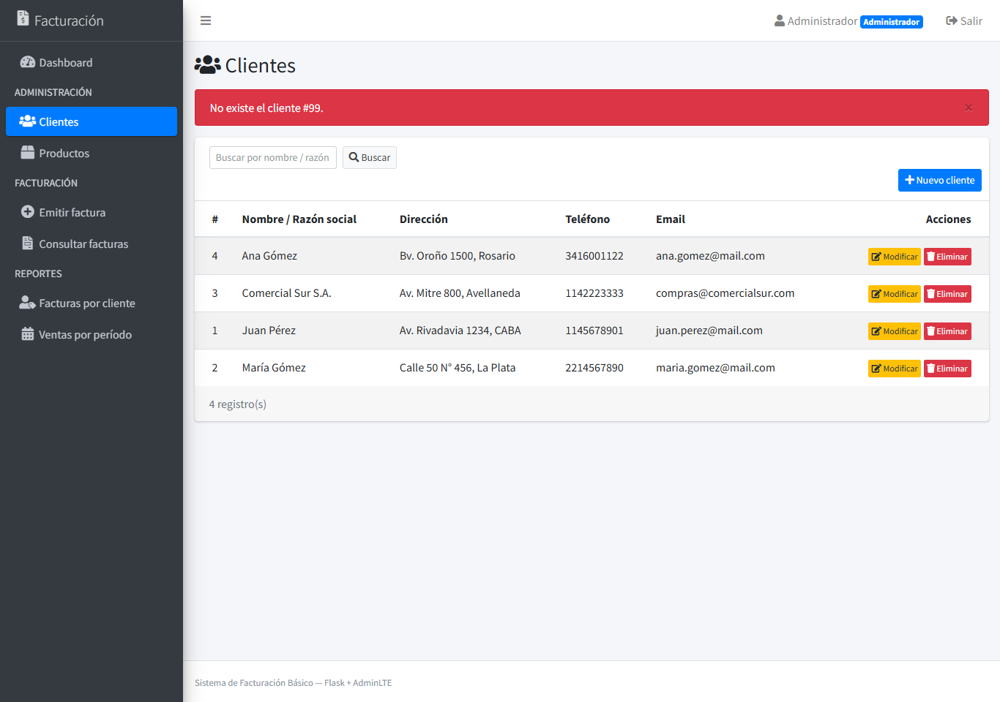

### CP-13 · Eliminar con confirmación (CU-02)

Precondición: Existe el cliente #4 (sin facturas).  
Pasos: Presionar Eliminar en Ana Gómez; primero elegir «No, volver»; después repetir y elegir «Sí, eliminar».  
Esperado: Antes de borrar aparece una pantalla «¿Seguro que querés eliminar este cliente?» con sus datos. Con «No» no se borra nada; con «Sí» se elimina.  
Resultado: OK, se probaron los dos caminos.

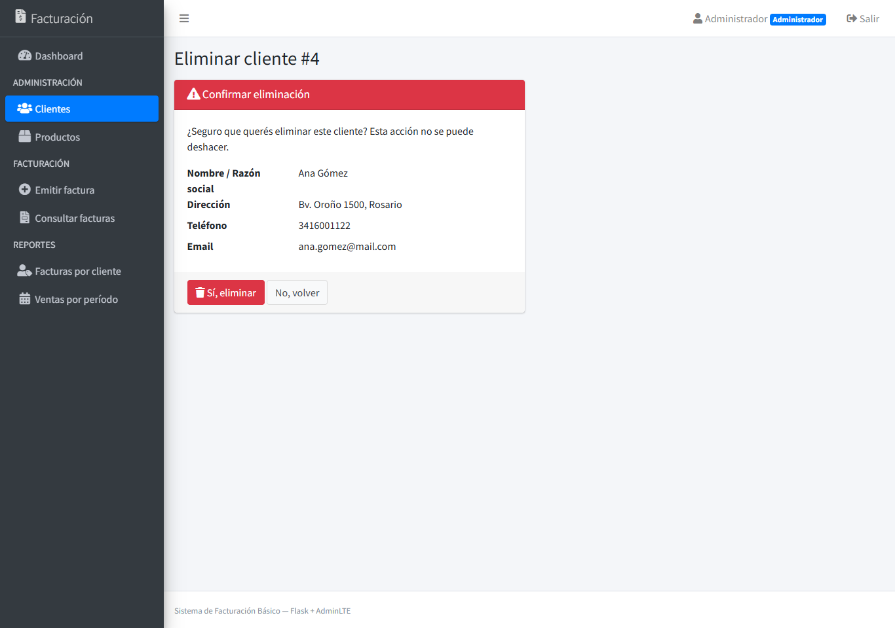
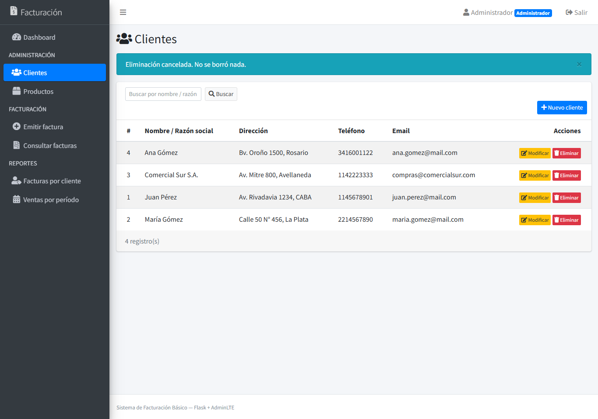
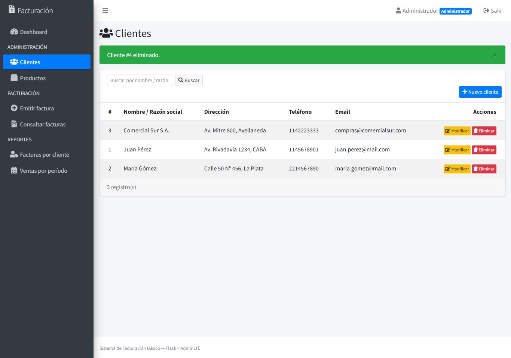

### CP-14 · Eliminar cliente con facturas (CU-02)

Precondición: Juan Pérez tiene facturas emitidas.  
Pasos: Presionar Eliminar en Juan Pérez.  
Esperado: «No se puede eliminar: el cliente tiene facturas emitidas.» y el cliente no se borra.  
Resultado: OK. Protege la integridad de la clave foránea facturas.id_cliente.

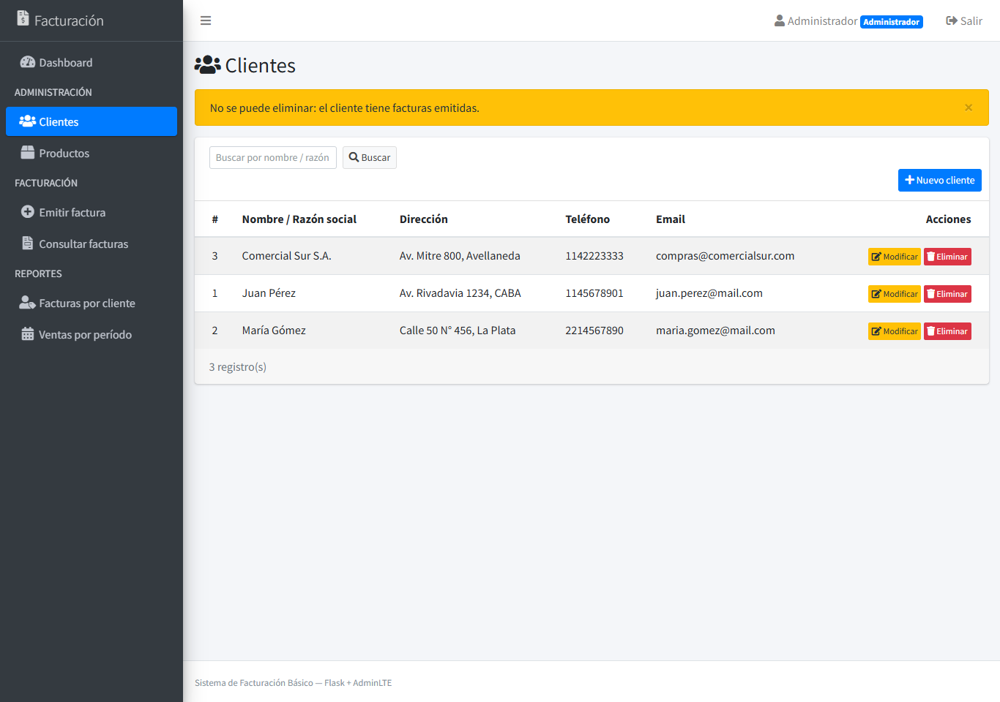

### CP-15 · Listado de productos (CU-03)

Precondición: Sesión de Administrador.  
Pasos: Entrar a Productos.  
Esperado: Tabla generada por la misma plantilla que Clientes; el precio se muestra con formato $ 1.234,50.  
Resultado: OK.

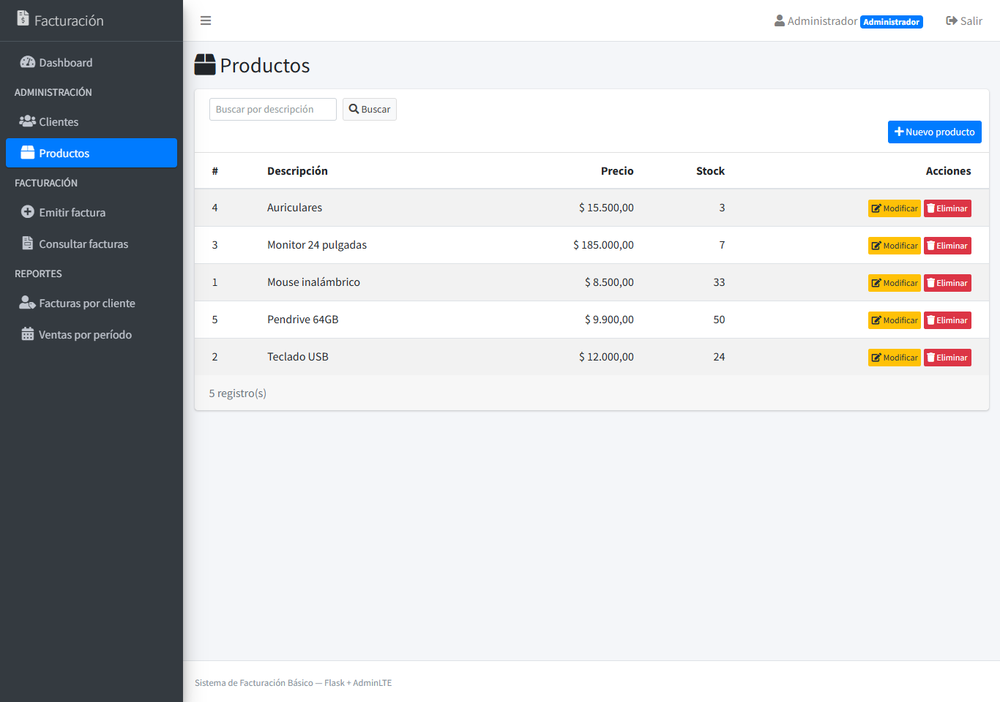

### CP-16 · Alta de producto con datos inválidos (CU-03)

Precondición: Formulario «Nuevo producto».  
Pasos: Cargar Descripción «X», Precio «abc» y Stock «-5»; presionar Guardar.  
Esperado: Tres mensajes: descripción muy corta, precio no numérico y stock no entero.  
Resultado: OK.

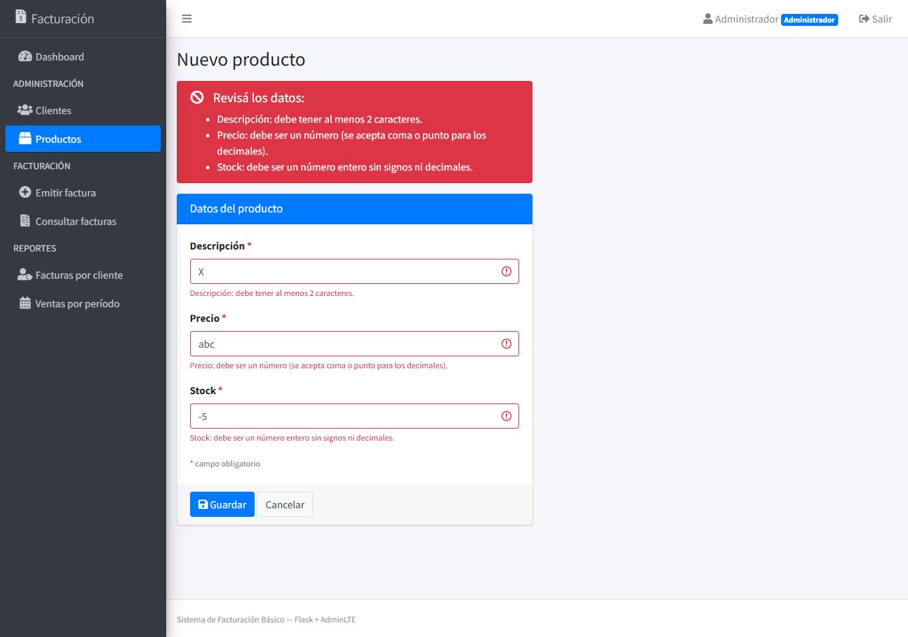

### CP-17 · Precio y stock fuera de rango (CU-03)

Precondición: Formulario «Nuevo producto».  
Pasos: Cargar «Cable HDMI», Precio «0» y Stock «250000».  
Esperado: «Precio: no puede ser menor que 0.01.» y «Stock: no puede ser mayor que 100000.»  
Resultado: OK.

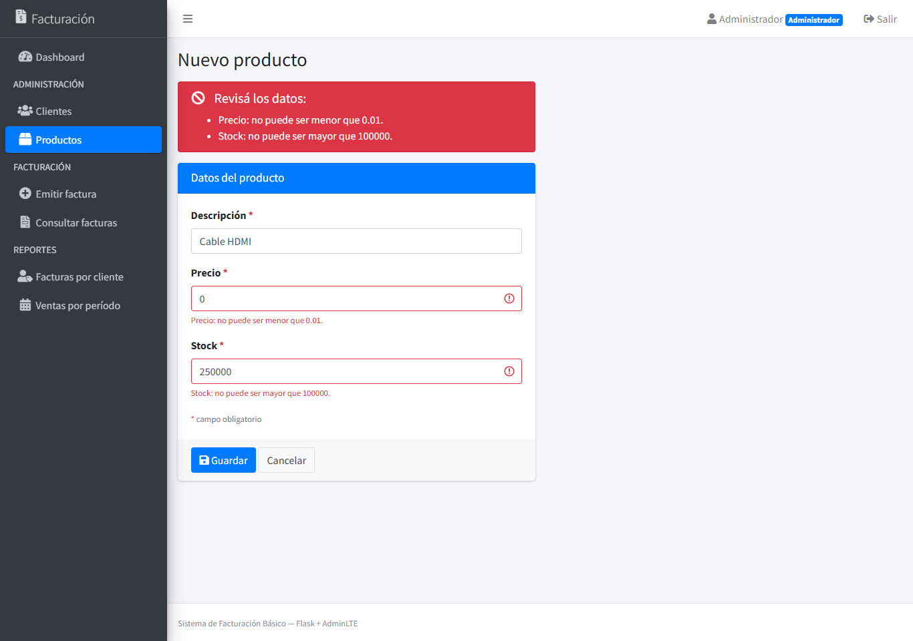

### CP-18 · Descripción de producto repetida (CU-03)

Precondición: Existe «Teclado USB».  
Pasos: Dar de alta otro producto «Teclado USB».  
Esperado: «Descripción: ya existe otro producto con ese valor.»  
Resultado: OK.

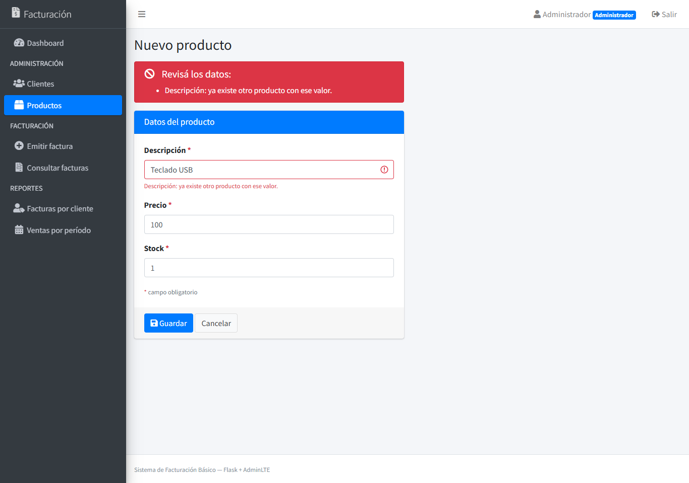

### CP-19 · Alta válida de producto (precio con coma) (CU-03)

Precondición: Formulario «Nuevo producto».  
Pasos: Cargar Cable HDMI / 4500,50 / 3; presionar Guardar.  
Esperado: «Producto #6 creado correctamente.» y el precio guardado como $ 4.500,50.  
Resultado: OK. Se acepta la coma decimal.

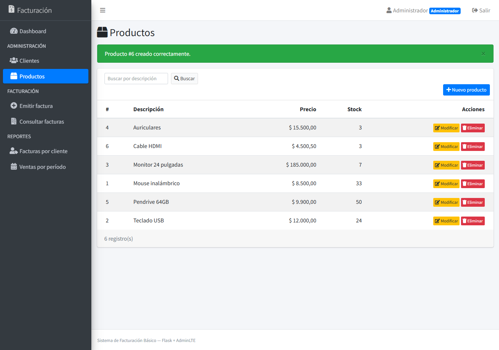

### CP-20 · Modificación de precio (CU-03)

Precondición: Existe «Teclado USB» a $ 12.000.  
Pasos: Modificar el precio a 13500.  
Esperado: «Producto #2 modificado correctamente.» y el nuevo precio en la tabla. Las facturas viejas mantienen el precio con el que se emitieron.  
Resultado: OK (el precio unitario queda guardado en detalle_factura).

### CP-21 · Eliminar producto usado en facturas (CU-03)

Precondición: «Mouse inalámbrico» figura en facturas.  
Pasos: Presionar Eliminar en Mouse inalámbrico.  
Esperado: «No se puede eliminar: el producto figura en facturas emitidas.»  
Resultado: OK.

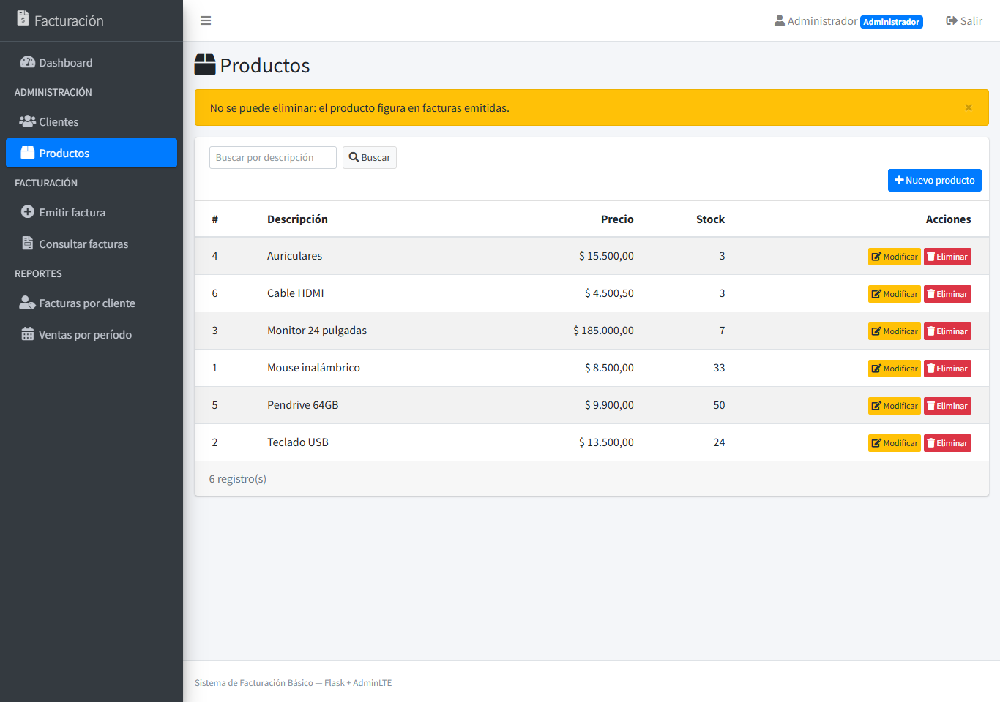

### CP-22 · Emitir factura sin cliente ni producto (CU-04)

Precondición: Pantalla «Emitir factura».  
Pasos: Presionar «Confirmar factura» sin elegir nada.  
Esperado: «Cliente: es obligatorio seleccionar uno.» y «Renglón 1: falta elegir el producto.» No se crea la factura.  
Resultado: OK.

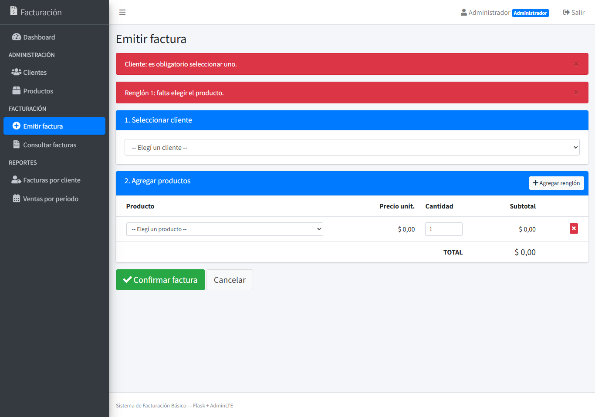

### CP-23 · Emitir factura sin stock suficiente (CU-04)

Precondición: «Cable HDMI» tiene stock 3.  
Pasos: Elegir María Gómez, Cable HDMI con cantidad 5 y confirmar.  
Esperado: «Stock insuficiente para «Cable HDMI»: pediste 5 y hay 3.» No se guarda nada y la pantalla conserva el cliente y los renglones cargados.  
Resultado: OK.

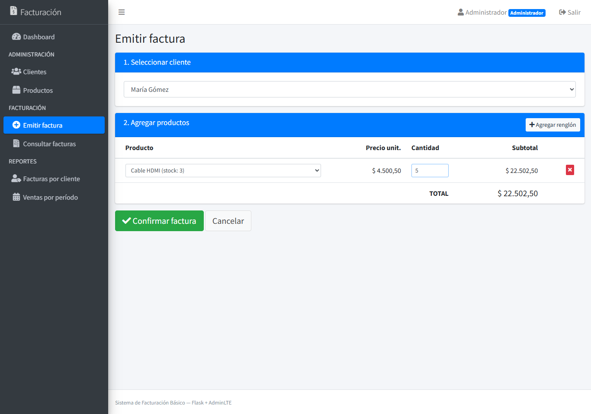
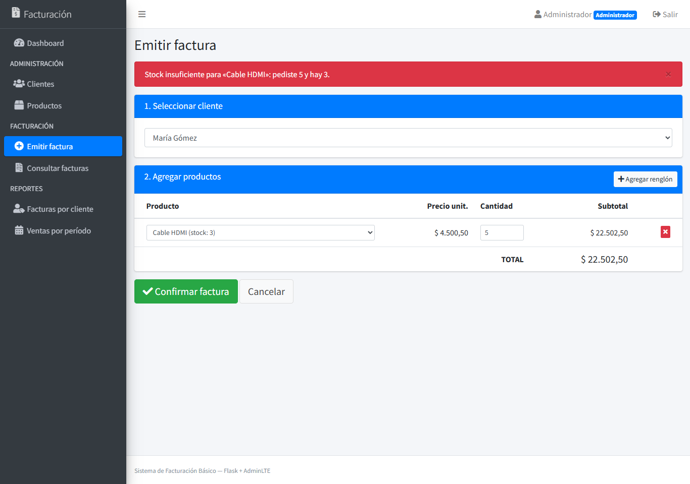

### CP-24 · Emisión válida de factura (CU-04)

Precondición: Continuación de CP-23.  
Pasos: Cambiar la cantidad a 3, agregar un renglón con Teclado USB × 2 y confirmar.  
Esperado: La pantalla muestra el total $ 40.501,50 antes de confirmar. Al confirmar: «Factura #5 emitida correctamente.», el detalle con los dos renglones y el stock descontado (Cable HDMI 3 → 0, Teclado USB 24 → 22).  
Resultado: OK. El total coincide: 3 × 4.500,50 + 2 × 13.500 = 40.501,50.

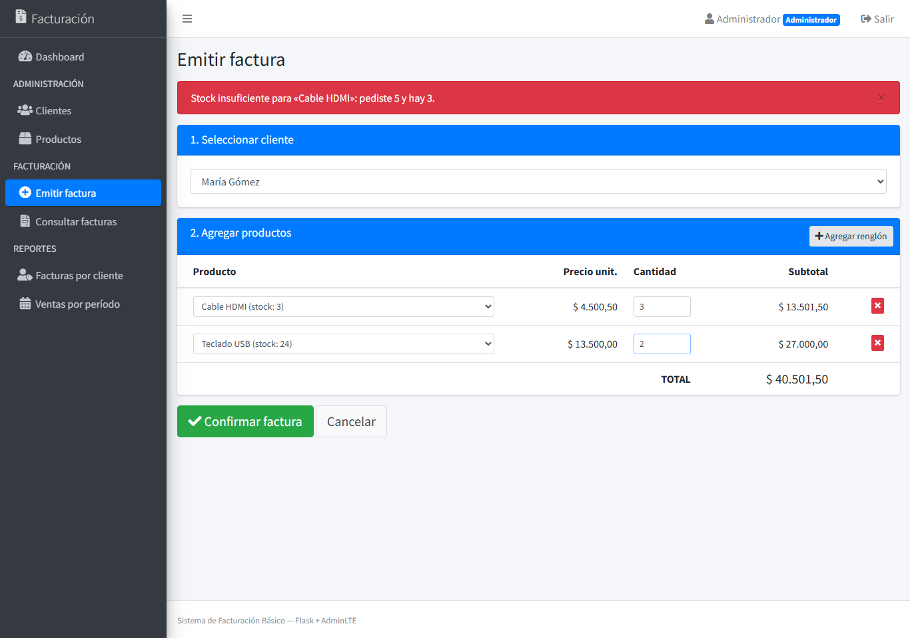
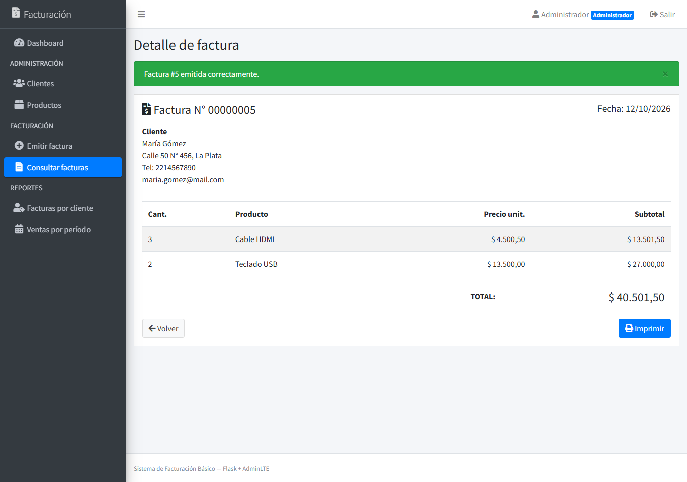
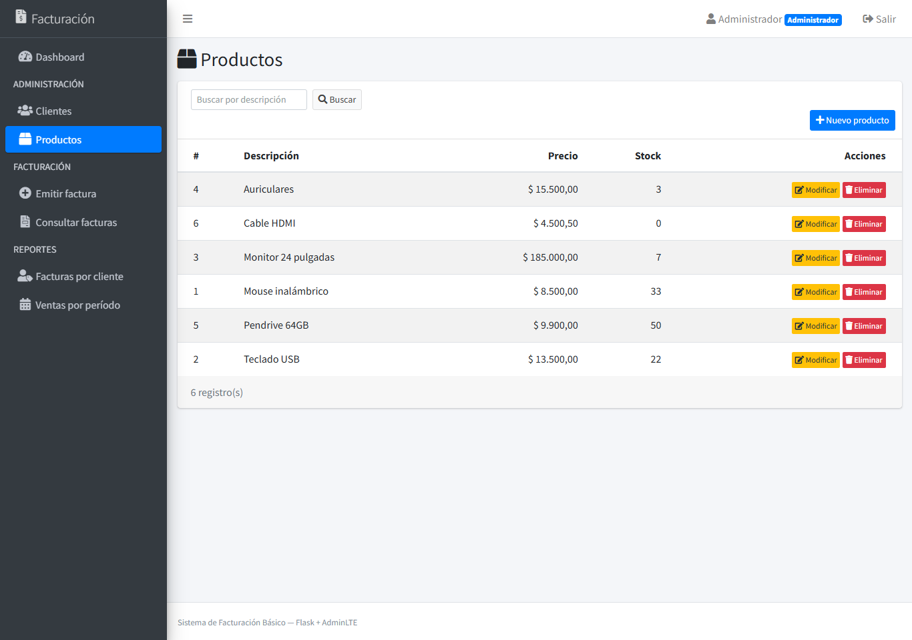

### CP-25 · Consultar facturas por cliente (CU-05)

Precondición: Juan Pérez tiene 2 facturas.  
Pasos: En «Consultar facturas» elegir Juan Pérez y presionar Buscar.  
Esperado: Se listan solo sus 2 facturas.  
Resultado: OK.

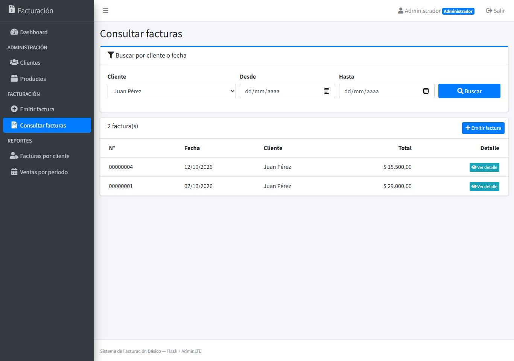

### CP-26 · Rango de fechas invertido (CU-05)

Precondición: Pantalla «Consultar facturas».  
Pasos: Buscar con Desde 31/12/2026 y Hasta 01/01/2026.  
Esperado: Aviso «La fecha 'Desde' no puede ser posterior a 'Hasta'.» y se listan todas.  
Resultado: OK.

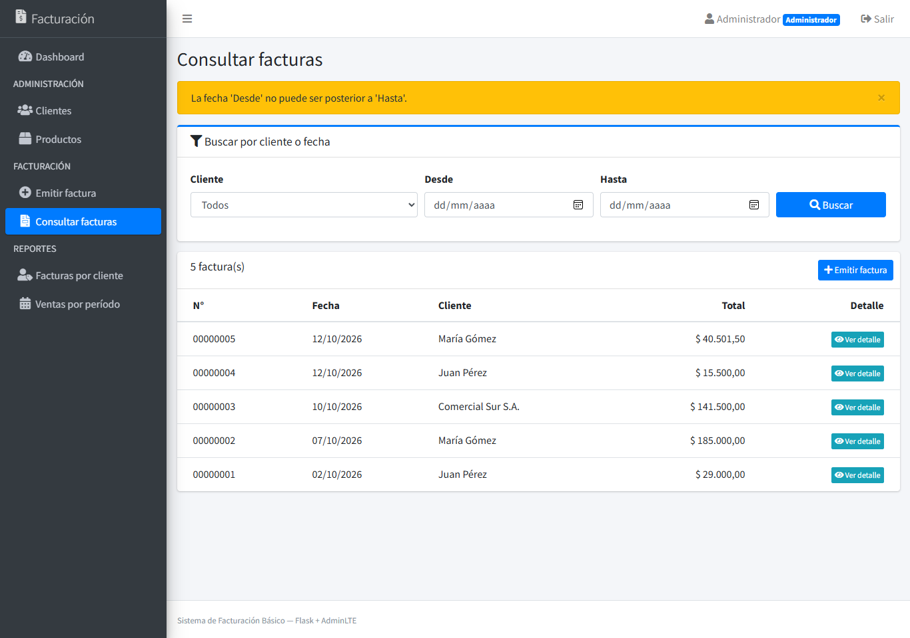

### CP-27 · Ver detalle de factura (CU-05)

Precondición: Existe la factura #1.  
Pasos: Presionar «Ver detalle» en la factura 00000001.  
Esperado: Se muestran cliente, fecha, renglones con precio unitario y subtotal, total y botón Imprimir.  
Resultado: OK.

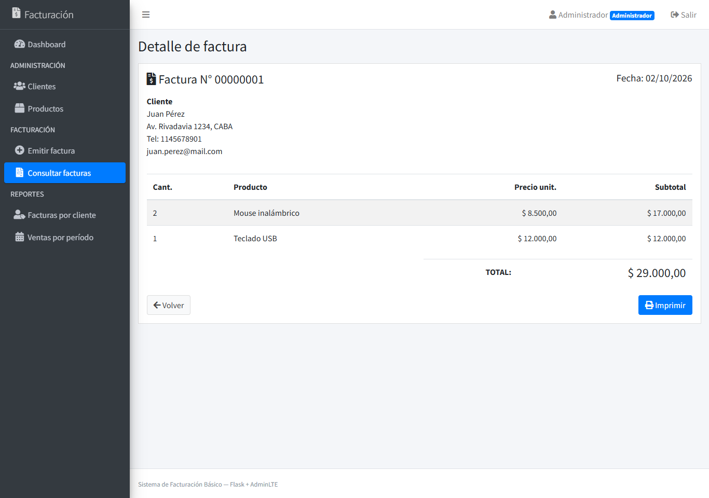

### CP-28 · Reporte de facturas por cliente (CU-06)

Precondición: Hay facturas emitidas.  
Pasos: Entrar a «Facturas por cliente».  
Esperado: Cada cliente con su cantidad de facturas, total facturado y el total general.  
Resultado: OK.

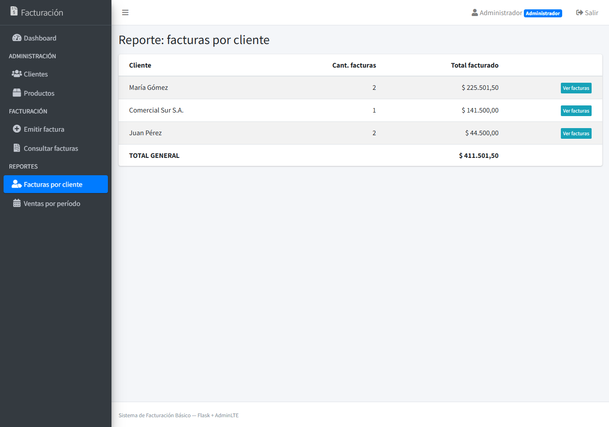

### CP-29 · Reporte de ventas por período (CU-07)

Precondición: Hay facturas en el mes actual.  
Pasos: Entrar a «Ventas por período» (por defecto, el mes actual).  
Esperado: Cantidad de facturas, total vendido y detalle por día.  
Resultado: OK.

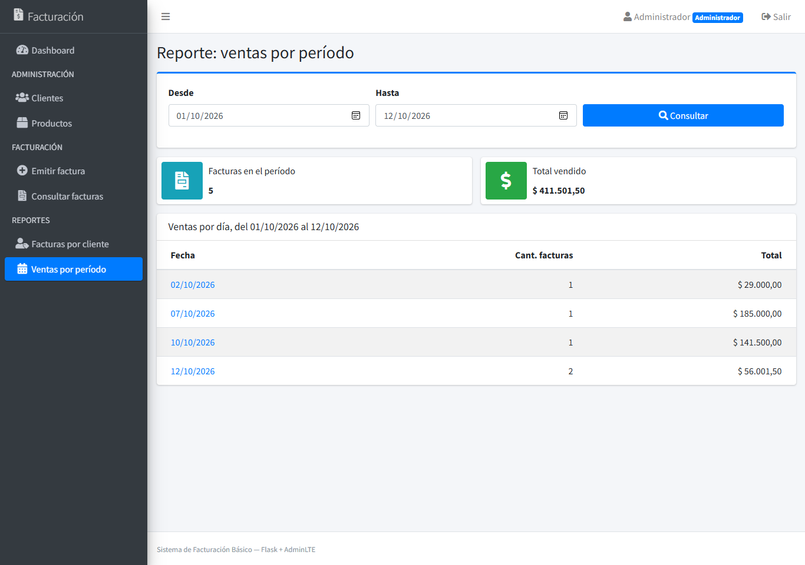

### CP-30 · Cerrar sesión (CU-01)

Precondición: Sesión iniciada.  
Pasos: Presionar Salir.  
Esperado: Vuelve al login con «Sesión cerrada.»; si después se intenta entrar a /dashboard, pide iniciar sesión.  
Resultado: OK.

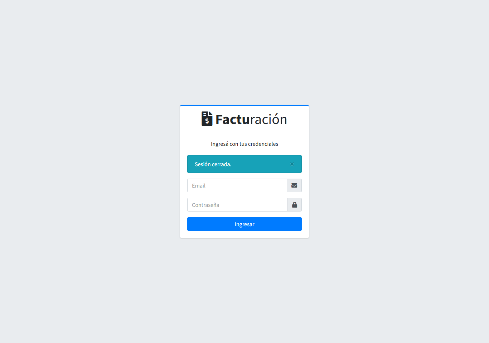

## Resumen

30 casos de prueba sobre 7 casos de uso — todos OK.
